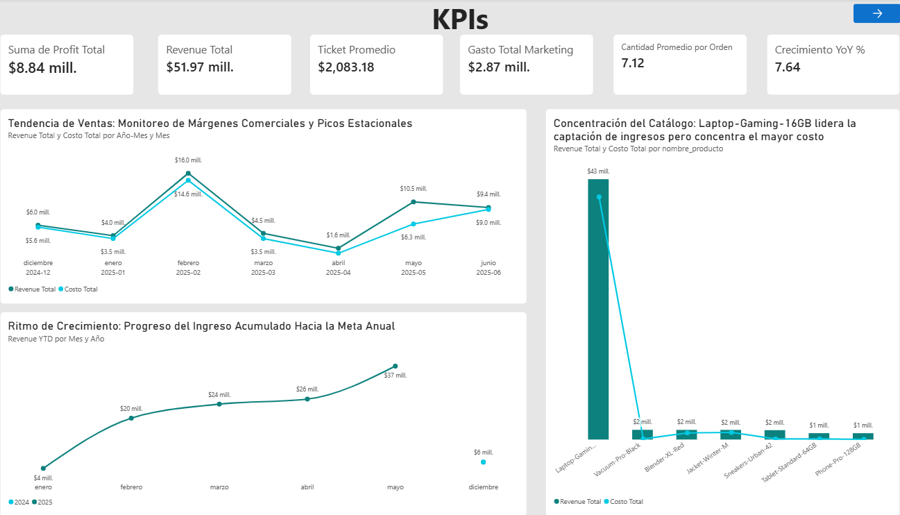
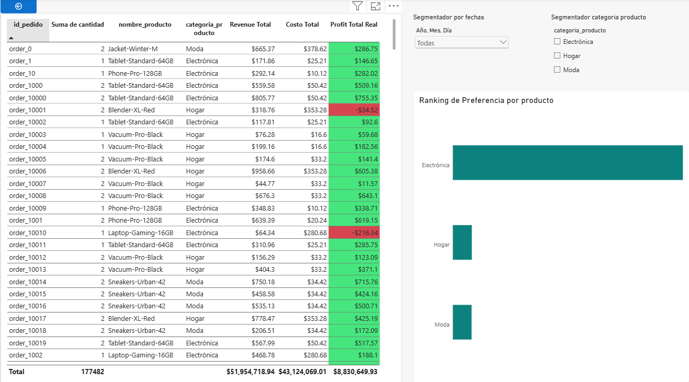

# RappiPlus Customer Performance & Business Optimization 🚀

Este repositorio contiene un caso de estudio de analítica avanzada aplicada a la evaluación del desempeño operativo y financiero del servicio **RappiPlus**. El proyecto integra un ciclo completo (End-to-End) de procesamiento y limpieza de datos en Python, modelado y consultas relacionales en SQL, pruebas estadísticas y el diseño de un ecosistema de Business Intelligence en Power BI.

---

## 🎯 Contexto y Problema de Negocio
El equipo ejecutivo de RappiPlus identificó la necesidad de auditar la salud financiera del servicio, comprender los puntos de fricción en la experiencia digital del usuario y medir el impacto real de las últimas actualizaciones de la interfaz. 

Este análisis busca responder a tres preguntas críticas de negocio:
1. ¿Es sostenible y rentable el modelo actual de cara al retorno de inversión en marketing (ROMI)?
2. ¿En qué etapa del embudo de conversión digital se están perdiendo la mayor cantidad de clientes potenciales?
3. ¿El nuevo rediseño de la interfaz de Checkout genera un incremento estadísticamente significativo en las transacciones?

---

## 🛠️ Tecnologías y Herramientas Utilizadas
*   **Python (Pandas, NumPy, Statsmodels):** Auditoría de calidad de datos, tratamiento de valores nulos/duplicados y computación estadística para pruebas A/B.
*   **SQL (PostgreSQL / BigQuery):** Construcción de consultas avanzadas para el cálculo de matrices de cohortes semanales y embudos de conversión (Funnels).
*   **Power BI:** Modelado de datos relacional (Estrella), desarrollo de métricas mediante DAX avanzado y diseño de dashboards ejecutivos.

---

## 📊 Proceso de Análisis y Etapas del Proyecto

### 1. Auditoría y Calidad de Datos (Python)
*   Estandarización de tipos de datos, remoción de registros duplicados e imputación lógica de valores faltantes.
*   Tratamiento de anomalías cronológicas en las marcas de tiempo de los eventos.

### 2. Modelado de Datos y Métricas de Negocio (SQL & Power BI)
*   **Embudo de Conversión:** Segmentación secuencial de eventos transaccionales desde la sesión inicial hasta la confirmación de pago.
*   **Análisis de Cohortes:** Agrupación de usuarios por su semana de adquisición para evaluar la retención y el ciclo de vida del cliente de manera longitudinal.

### 3. Validación Estadística (A/B Testing)
*   Formulación de hipótesis sobre el rediseño de la interfaz.
*   Implementación de una prueba de proporciones de dos muestras (**Z-Test**) para evaluar la tasa de conversión entre el grupo de control y el grupo de tratamiento.

---

## 📈 Hallazgos Clave y Conclusiones de Negocio

| Área de Análisis | Métrica / Resultado | Impacto e Insight de Negocio |
| :--- | :--- | :--- |
| **Diagnóstico Financiero** | Margen Bruto: **17.02%**   ROMI: **207.92%** | El modelo actual es altamente rentable. Los esfuerzos de adquisición de marketing están más que duplicando el retorno de inversión. |
| **Embudo de Conversión** | Fuga: **-1,249 usuarios** | El principal cuello de botella se localiza estrictamente entre *Add to Cart* y *Begin Checkout*. Hay fricción crítica antes de iniciar el pago. |
| **Análisis de Cohortes** | Retención en W3: **~65%** | La lealtad del cliente se estabiliza de forma sólida en la tercera semana, lo que valida la propuesta de valor del servicio post-adquisición. |
| **Prueba de Hipótesis** | p-value: **0.416** | **No se rechaza la hipótesis nula.** El nuevo rediseño visual de la interfaz no generó un impacto estadísticamente significativo en las ventas. |

---

## 🚀 Recomendaciones Estratégicas
1. **Optimización del Checkout:** Descartar la implementación definitiva del rediseño evaluado en el Test A/B. Se recomienda enfocar los recursos de desarrollo en resolver la fricción previa al pago (paso de *Add to Cart* a *Begin Checkout*) mediante simplificación de flujos o incentivos dinámicos.
2. **Gestión de Costos:** Iniciar negociaciones estratégicas de costos unitarios para empujar el margen bruto por encima del umbral actual, aprovechando la sólida retención de usuarios ganada hacia la tercera semana.

---

## 🖼️ Vista Previa del Dashboard

### Vista 1: Overview Ejecutivo

### Vista 2: Detalle y Drill-through de Operaciones

---

## 📂 Estructura del Repositorio
*   `rappiplus_dashboard.pbix`: Archivo origen de Power BI con el modelo relacional, ETL y medidas DAX.
*   `Proyecto_Final_rappiplus.ipynb`: Jupyter Notebook con el código documentado de la limpieza de datos y cálculos estadísticos del Z-Test.

O también puedes usar este enlace directo: [Abrir en Google Colab](https://colab.research.google.com/drive/1ZPPpKbCv5m1BYZ97uR5etPwJ9Rq5oOBL)

