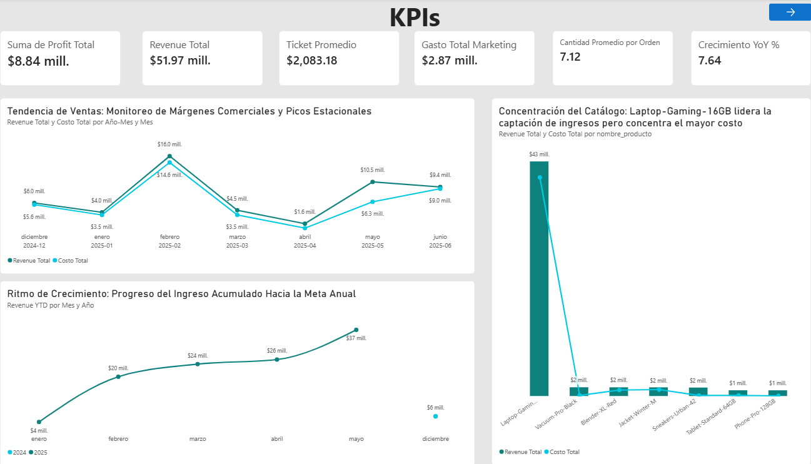
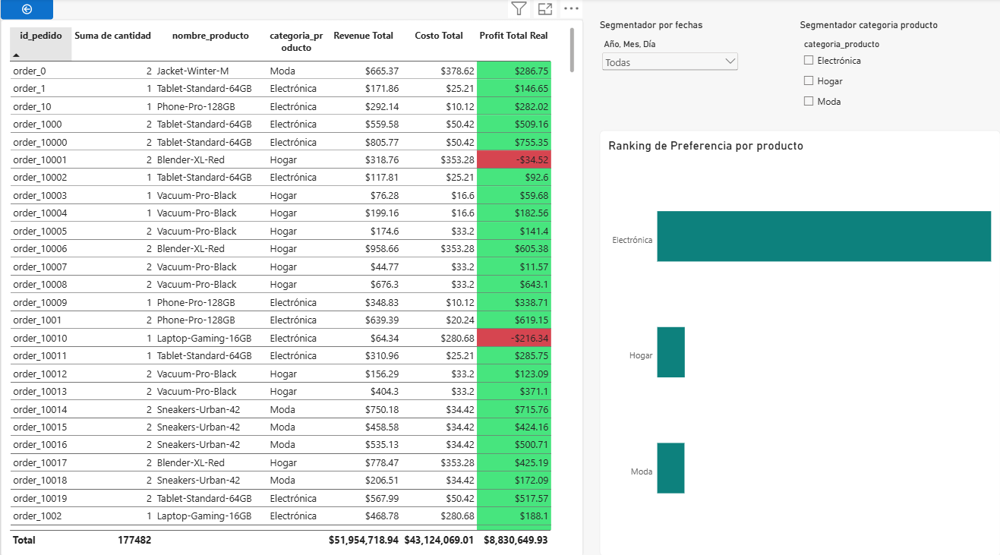

# RappiPlus Customer Performance and Business Optimization – Proyecto Final

Este repositorio contiene el proyecto final de analítica avanzada para evaluar el desempeño e impacto operativo de **RappiPlus**, integrando limpieza en **Python**, consultas en **SQL** y **Pruebas de Hipótesis (Z-Test)**.

## Contenido del repositorio

* `rappiplus_dashboard.pbix`: Archivo principal de Power BI con el modelo relacional y medidas DAX.
* `Proyecto_Final_rappiplus.ipynb`: Jupyter Notebook con la auditoría de datos, KPIs y análisis estadístico.

---

## 🖼️ Vista Previa del Dashboard

### Vista 1: Overview Ejecutivo

### Vista 2: Detalle y Drill-through de Operaciones

---

## Cómo abrir el notebook en Google Colab

Haz clic en el siguiente botón:

O:

1. Haz clic en [**Open in Colab**](https://colab.research.google.com/drive/1ZPPpKbCv5m1BYZ97uR5etPwJ9Rq5oOBL#scrollTo=9b6c0152)

---

## 🎯 Objetivos y Fases del Análisis

* **Limpieza (Python):** Estandarización y eliminación de duplicados o valores inválidos.
* **Diagnóstico Financiero:** Análisis de ganancias netas, margen bruto y ROMI.
* **Embudo de Conversión (SQL):** Identificación de cuellos de botella en eventos transaccionales.
* **Cohortes (SQL):** Evaluación de retención semanal y lealtad.
* **A/B Testing:** Validación mediante Z-test de cambios en la interfaz.

---

## 📈 Hallazgos y Decisiones de Negocio

* **Rentabilidad:** Negocio altamente rentable con un Margen Bruto del 17.02% y ROMI del 207.92%.
* **Embudo:** La mayor fuga ocurre entre *Add to Cart* y *Begin Checkout* (pérdida de 1,249 usuarios).
* **Retención:** Estabilización sólida en la Semana 3 en torno al 65%.
* **A/B Testing:** El p-value (0.416) indica que no se rechaza la hipótesis nula; el rediseño no generó impacto significativo.

---

## 🚀 Recomendaciones

1. Negociar costos unitarios para mejorar el margen bruto.
2. Descartar la implementación del rediseño de checkout y enfocar esfuerzos en la fricción previa al pago.
